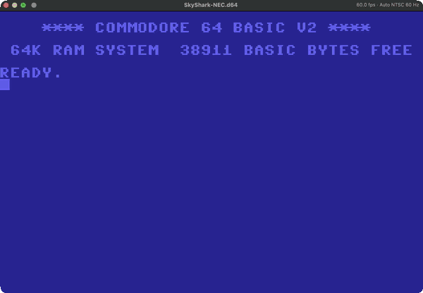
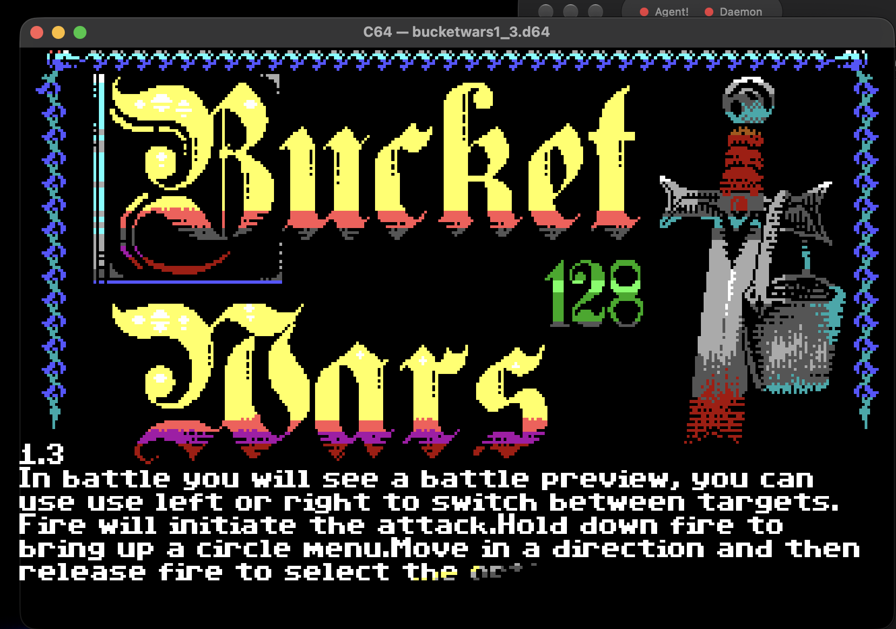
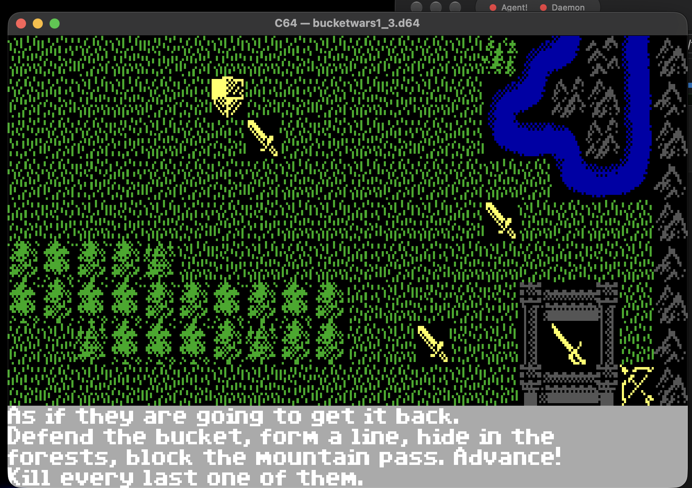

# C64 is a Commodore 64/128 emulator for macOS

## Created by Todd Bruss

Native Swift/AppKit emulator of a Commodore 64 (NTSC or PAL) and Commodore 128 (with the Z80 and
CP/M 3.0), with true emulation of the 1541, 1571 and 1581 disk drives and the Datasette. The only dependency is [AutoUpdateKit](https://github.com/AgentiLoop/AutoUpdateKit),
which keeps the app up to date from GitHub releases.

| Website | Download | Built with |
|:---:|:---:|:---:|
| [c64.xcf.ai](https://c64.xcf.ai) | [Latest release](https://github.com/AgentiLoop/c64/releases/latest) | [AgentiLoop Agent!](https://agentiloop.ai) |

<table>
  <tr>
    <td width="50%"></td>
    <td width="50%"></td>
  </tr>
</table>

## Quick start

1. Download `C64.app.zip` from the [releases page](https://github.com/AgentiLoop/c64/releases/latest),
   unzip it and open it, or build it yourself (see [Build & run](#build--run)). The release is a
   Universal app (Apple silicon and Intel), signed with Developer ID and notarized by Apple.
2. Supply the Commodore ROMs (see [ROMs](#roms)).
3. **Drag and drop a `.d64` disk image onto the C64 screen** to insert it in drive 8 and autostart it
   (`LOAD"*",8,1` + `RUN`). `.g64`, `.d71`, `.d81`, `.prg`, `.p00`, `.t64`, `.tap` and `.crt` files work
   the same way, or use the Drive and Tape menus.

Requires macOS 14 or later.

## Commodore 128 built in

The same app is also a Commodore 128. **Machine ▸ Commodore 128** restarts it in C128 mode with
BASIC 7.0, 128K, the 40-column VIC-II screen and the 80-column 8563 VDC screen.
**View ▸ C128 Display** (⌘4 / ⌘5 / ⌘6) switches the window between the two video outputs, like the
input switch on a monitor. **CP/M 3.0** runs on the emulated Z80: boot a CP/M system disk, and
use raw `.img` MFM disks (Kaypro, IBM) in the 1571. Hold Option while the app starts, or use
Machine ▸ Reset Holding C= (⌥⌘R), to start a C128 in C64 mode. It needs the C128 ROMs
(see [ROMs](#roms)); the details are in the [Status](#status) table.

<table>
  <tr>
    <td width="50%"></td>
    <td width="50%"></td>
  </tr>
  <tr>
    <td align="center">Bucket Wars 1.3 title screen, 80 columns</td>
    <td align="center">Bucket Wars 1.3 map, 80 columns</td>
  </tr>
</table>

## Status

| Part | State |
|------|-------|
| 6510 CPU | Cycle-exact bus accesses, all documented + undocumented opcodes, passes Klaus Dormann's functional test |
| Video standard | NTSC (6567R8, 60 Hz, default), PAL (6569, 50 Hz) or Auto via Machine ▸ Video Standard; Auto switches to PAL live when a program needs PAL-only raster lines or cycle-counted PAL raster bars; CPU, SID pitch, CIA clocks and drive timing follow; the KERNAL detects the machine itself |
| Commodore 128 | Machine ▸ Commodore 128 boots C128 mode with BASIC 7.0 (122365 bytes free): 8722 MMU with 128K in two banks, common RAM, page 0/1 relocation, ROM/RAM configurations and the $FF00 registers; as on the real machine the Z80 runs first (its boot BIOS from the KERNAL ROM) and hands the bus to the 8502 through MMU $D505. 40 columns on the VIC-II, and 80 columns on the 8563 VDC (text with attributes, alternate character set, underline, reverse, blinking cursor, bitmap mode, character width/height up to 16×32, smooth scrolling): the window shows whichever screen the C128 is using, so ESC X switches, and View ▸ C128 Display (Automatic ⌘4 / 40 Columns ⌘5 / 80 Columns ⌘6) picks the video output by hand, like the input switch on a monitor, for programs that ask you to switch; Machine ▸ C128 Starts in 80 Columns holds the 40/80 key down at reset; `GO64` switches to C64 mode (the menu follows; drive 8 stays a 1571 with its disk, as on a C128D; the next launch boots the C128 again); holding Option while the app starts, or Machine ▸ Reset / Hard Reset Holding C= (⌥⌘R / ⌥⇧⌘R, shown while Option is held), holds C= at power-on so the C128 starts in C64 mode. The extra C128 keys (HELP, ESC, TAB, ALT, LINE FEED, NO SCROLL, keypad and top-row cursor keys) are scanned through $D02F. `FAST`/`SLOW` switch the 8502 between 2 MHz and 1 MHz ($D030 bit 0; the 40-column picture is not meaningful while fast, as on the real machine). With the 1571 ROM, drive 8 is a true-emulated 1571 in C128 mode (as in a C128D): fast serial burst transfers over the CIA serial ports, 2 MHz, both heads, D71 images (read and written back); otherwise disk LOAD/SAVE work through the true-emulated 1541 (Instant Load is C64-only); at start-up the KERNAL checks drive 8 for a boot disk, as a real C128 does, and goes to READY. without one. **CP/M 3.0**: the Z80 (all documented and common undocumented instructions; passes ZEXDOC) and the 8502 switch through $D505 bit 0 as on the real machine, so a CP/M system disk (D64/G64, GCR) boots with `BOOT` or at power-on and runs on the 40-column screen (80 columns with the 40/80 key down; switch the display with ⌘6). MFM disks for CP/M work on the 1571's WD1770: open a raw 40-track `.img` (Kaypro II/IV, IBM-8 SS/DS CP/M-86, IBM-9; recognised by size, changes written back); when two formats look alike CP/M shows them on the status line, pick one with the C128's top-row ← → keys (End / Page Down on the Mac) and RETURN |
| VIC-II (6569) | Cycle-stepped: badlines, sprite DMA/cycle stealing, border flip-flops, raster IRQ, all text/bitmap modes, sprites + collisions |
| SID (6581) | 3 voices, all waveforms, sync/ring, ADSR with real rate tables, resonant multimode filter, digi (volume DC) |
| CIA 6526 ×2 | Timers A/B, TOD, ICR, keyboard/joystick ports, VIC bank, IEC lines, NMI |
| Keyboard | Mac keyboard → C64 matrix (symbolic punctuation), RESTORE, joystick on numpad / cursor keys / game controllers |
| Drive light | Round light at the left of the title bar: gray idle, green reading, orange writing a file, yellow appending, red deleting (scratch), purple formatting (`N0:NAME,ID`), pink erasing (`N0:NAME`, clears the directory); hover for the name |
| 1541 drive | True emulation: drive 6502 running the original DOS ROM, 2× VIA 6522, stepper head, GCR disk at the correct zone speeds; reads and writes |
| Media | D64 (autostart `LOAD"*",8,1` + `RUN`, Drive menu attach/eject/new blank disk, changes written back to the .d64), G64 raw GCR images with half-tracks (for copy-protected disks; changes written back as G64), D71 double-sided 1571 images (C128 mode), raw `.img` MFM CP/M disks in the 1571, PRG and P00 autostart, CRT cartridges (normal 8K/16K/Ultimax, Ocean, Magic Desk, EasyFlash, C64 Game System, Dinamic, Simons' BASIC, Epyx FastLoad; File ▸ Remove Cartridge; in C128 mode a cartridge starts C64 mode as on the real machine). T64 autostart, D81 on drive 9 (autostart `LOAD"*",9,1` + `RUN`) |
| 1581 drive (3.5") | True emulation as device 9: 2 MHz 6502 running the original 1581 DOS ROM, 8520 CIA, WD1772 controller (seek/step/restore, read/write sector, read address with real CRCs, write track so the drive's own `N:` format works), 80 tracks × 2 sides × 10 × 512-byte sectors; D81 attach/eject/new blank, changes written back |
| Fast loading | Instant Load (KERNAL LOAD trap for drives 8/9, on by default) and automatic warp while a drive motor runs (Drive menu) |
| Datasette | TAP v0/v1 playback into CIA1 FLAG at cycle precision, recording from the cassette write line (KERNAL SAVE to tape), TAP autostart (`LOAD` + `RUN`), Tape menu (insert/new/play/record/stop/rewind/eject), automatic warp while the tape motor runs, recordings written back to the .tap |

## Instant-on disk drives

No more waiting on the 1541. Instant Load catches the C64's own `LOAD` command and copies the file
straight out of the disk image into memory, so `LOAD"*",8,1` finishes in a blink instead of a minute
or more over the slow serial bus. It works for drive 8 (1541, D64) and drive 9 (1581, D81) and is on
by default.

* The directory (`LOAD"$",8`) and games with their own fast loaders or copy protection still go
  through the real emulated drive, so they behave exactly like the hardware.
* Anything that does use the real drive runs in automatic warp while the drive motor spins
  (Drive ▸ Warp While Disk Loads).
* Toggle it with ⌘L (Drive ▸ Instant Load) if you want the authentic wait.

## Dial-up BBSes over telnet

A Hayes-style modem "dials" internet hosts instead of phone numbers, like the WiFi modems people
plug into real C64s. Plenty of Commodore BBSes are still online: see the [BBS list](docs/BBS-LIST.md).

1. Choose **Modem ▸ Interface**, then **Modem ▸ Load Terminal Program**. The built-in terminal (machine code,
   PETSCII colour graphics, blinking cursor) starts on that interface: user port 1200, SwiftLink 38,400 or
   Turbo232 230,400 baud. In C128 mode it loads a C128 build of the terminal (`TERM128.PRG` at $1C01)
   that prints on whichever screen is active: start the C128 in 80 columns
   (Machine ▸ C128 Starts in 80 Columns) for an 80-column terminal on the VDC, or press **F2** to
   switch between 40 and 80 columns.
2. Pick a board from **Modem ▸ Phone Book**, or type `ATDT host:port` in the terminal
   (e.g. `ATDT oasisbbs.hopto.org:6400`).
3. Hang up with **F7** in the terminal, **Modem ▸ Hang Up**, or `+++` (wait a second) and `ATH`.
4. **F1** switches the terminal between PETSCII (Commodore boards) and ASCII/ANSI (PC-style boards such
   as Synchronet). ASCII/ANSI mode translates upper/lower case both ways, shows ANSI colours, clears the
   screen, positions and moves the cursor, draws CP437 line graphics with the nearest PETSCII
   characters, answers the ANSI detection request (`ESC[6n`) and sends cursor keys as ANSI. Lines are
   40 columns wide.
5. **F3** downloads a file with XMODEM (checksum, 128-byte blocks) to drive 8: type a file name,
   then start the upload on the BBS. The file is saved as a PRG, bad blocks are requested again, the
   `$1A` padding at the end is removed, and STOP cancels. Put a disk in drive 8 first
   (Drive ▸ New Blank Disk…).
6. **F5** uploads a file from drive 8 with XMODEM (checksum): type its name, then start the download
   on the BBS. The last block is padded with `$1A`, rejected blocks are sent again, and STOP cancels.

**Modem ▸ Interface** chooses where the modem is plugged in:

| Interface | Speed | Notes |
|-----------|-------|-------|
| User Port | 300–2400 baud (up to 9600 with fast drivers) | Standard wiring: TXD on PA2, RXD on PB0 + FLAG, DCD on PB4. The modem follows the C64's speed from the "AT" it sends. |
| SwiftLink $DE00 | up to 38,400 baud | 6551 ACIA cartridge, interrupt on NMI, rates doubled by its 3.6864 MHz crystal. Hang up by dropping DTR works. |
| Turbo232 $DE00 | up to 230,400 baud | SwiftLink plus the enhanced speed register at $DE07 (57,600 / 115,200 / 230,400). |

The built-in terminal has been tested live against The Oasis BBS on SwiftLink (38,400) and Turbo232
(230,400). Other terminals that support these interfaces work too, e.g.
[CCGMS Future](https://github.com/mist64/ccgmsterm) (F7 ▸ Modem Type "Swift / Turbo DE", Baud Rate 38400),
which adds more transfer protocols (Punter, XMODEM-CRC/1K). The terminal's source is `scripts/make-term.py` (a small built-in 6502 assembler).

* Commands: `ATD`/`ATDT host[:port]` (port 23 by default), `ATH`, `ATO`, `ATZ`, `ATE0`/`ATE1`, `ATI`,
  `A/`; other settings are accepted with `OK`.
* Telnet option requests are answered and raw TCP boards work as well.
* The modem never overruns the C64: it waits while the KERNAL's 256-byte receive buffer is nearly
  full (user port) or until the last byte has been read (SwiftLink), so even a BASIC terminal
  doesn't lose characters.

## ROMs

The Commodore ROMs are copyrighted and are not part of this repository. On first launch the
app looks in `~/Library/Application Support/C64Emu/ROMs` and otherwise asks for a folder containing
`basic*.bin`, `kernal*.bin`, `chargen*.bin` (and optionally `dos1541*.bin`, `dos1571*.bin`, `dos1581*.bin`
and the C128 ROMs below).

Preferred file names (files are matched by name prefix and must be exactly this size):

**Commodore 64**

| ROM | File name | Size | |
|---|---|---|---|
| BASIC | [`basic-901226-01.bin`](https://raw.githubusercontent.com/VICE-Team/svn-mirror/main/vice/data/C64/basic-901226-01.bin) | 8 KB (8192 bytes) | required |
| KERNAL | [`kernal-901227-03.bin`](https://raw.githubusercontent.com/VICE-Team/svn-mirror/main/vice/data/C64/kernal-901227-03.bin) | 8 KB (8192 bytes) | required |
| CHARGEN | [`chargen-901225-01.bin`](https://raw.githubusercontent.com/VICE-Team/svn-mirror/main/vice/data/C64/chargen-901225-01.bin) | 4 KB (4096 bytes) | required |
| 1541 DOS | [`dos1541-325302-01+901229-05.bin`](https://raw.githubusercontent.com/VICE-Team/svn-mirror/main/vice/data/DRIVES/dos1541-325302-01%2B901229-05.bin) | 16 KB (16384 bytes) | optional, drive 8 (also used in C128 mode) |
| 1581 DOS | [`dos1581-318045-02.bin`](https://raw.githubusercontent.com/VICE-Team/svn-mirror/main/vice/data/DRIVES/dos1581-318045-02.bin) | 32 KB (32768 bytes) | optional, drive 9 (also used in C128 mode) |

**Commodore 128** (in addition to the C64 ROMs above)

| ROM | File name | Size | |
|---|---|---|---|
| C128 KERNAL | [`kernal-318020-05.bin`](https://raw.githubusercontent.com/VICE-Team/svn-mirror/main/vice/data/C128/kernal-318020-05.bin) | 16 KB (16384 bytes) | needed for C128 mode |
| C128 BASIC low | [`basiclo-318018-04.bin`](https://raw.githubusercontent.com/VICE-Team/svn-mirror/main/vice/data/C128/basiclo-318018-04.bin) | 16 KB (16384 bytes) | needed for C128 mode |
| C128 BASIC high | [`basichi-318019-04.bin`](https://raw.githubusercontent.com/VICE-Team/svn-mirror/main/vice/data/C128/basichi-318019-04.bin) | 16 KB (16384 bytes) | needed for C128 mode |
| C128 CHARGEN | [`chargen-390059-01.bin`](https://raw.githubusercontent.com/VICE-Team/svn-mirror/main/vice/data/C128/chargen-390059-01.bin) | 8 KB (8192 bytes) | needed for C128 mode |
| 1571 DOS | [`dos1571-310654-05.bin`](https://raw.githubusercontent.com/VICE-Team/svn-mirror/main/vice/data/DRIVES/dos1571-310654-05.bin) | 32 KB (32768 bytes) | optional, drive 8 in C128 mode (and in C64 mode with Machine ▸ C64 Drive 8 Is a 1571) |

## Build & run

```sh
./scripts/make-app.sh      # builds build/C64.app
open build/C64.app
swift test -c release -Xswiftc -enable-testing   # unit + boot tests
C64_SLOW_TESTS=1 swift test -c release -Xswiftc -enable-testing --filter testFormat   # 1581 full format (~45 s)
```

## Keys

| Mac | C64 |
|-----|-----|
| Esc | RUN/STOP |
| Page Up | RESTORE |
| Help (Insert), F9, F10, F11, F12, F13 | C128 mode: HELP, ESC, TAB, ALT, LINE FEED, NO SCROLL (the extra keys, scanned through $D02F) |
| End / Page Down | C128 mode: the top-row ← / → cursor keys (CP/M uses them to pick a disk format) |
| Left Option | C= |
| Tab / Control | CTRL |
| Home | CLR/HOME |
| F1–F8 | F1–F8 |
| Backspace / Fwd Delete | DEL / INST |
| Numpad 8/2/4/6, 0 or Right Option | Joystick (port 2 by default, ⌘K swaps) |
| ⌘V | Paste text as typing |
| ⌘J | Warp mode |
| ⌘R / ⌘⇧R | Reset / hard reset |
| ⌥⌘R / ⌥⇧⌘R | Reset / hard reset holding C= (a C128 starts in C64 mode); hold Option at launch for the same |
| ⌘1 / ⌘2 / ⌘3 | View: full border / small border / no border |
| ⌘4 / ⌘5 / ⌘6 | View: C128 display automatic / 40 columns (VIC-II) / 80 columns (VDC), like the input switch on a monitor |
| ⌘D / ⌘E / ⌘N | Attach / eject / create D64 in drive 8 |
| ⌘L | Instant Load on/off (copies files straight from the disk image; directory, custom loaders still use the real drive) |
| ⌘P | Pause / resume (handy for screenshots) |
| ⌘⇧D / ⌘⇧E / ⌘⇧N | Attach / eject / create D81 in drive 9 (1581) |
| ⌘T / ⌘⇧T | Insert TAP / new blank TAP |
| ⌘⌥1–4 | Tape play / record / stop / rewind |

## License

The C64 emulator source in this repository is MIT licensed, see [LICENSE](LICENSE). This license does not cover AgentiLoop Agent!, the tool it was made with. Commodore ROMs and game software are not included and remain the
property of their owners.

## Website

`site/` is the source of https://c64.xcf.ai (static Cloudflare Worker assets): `cd site && npx wrangler deploy`.
