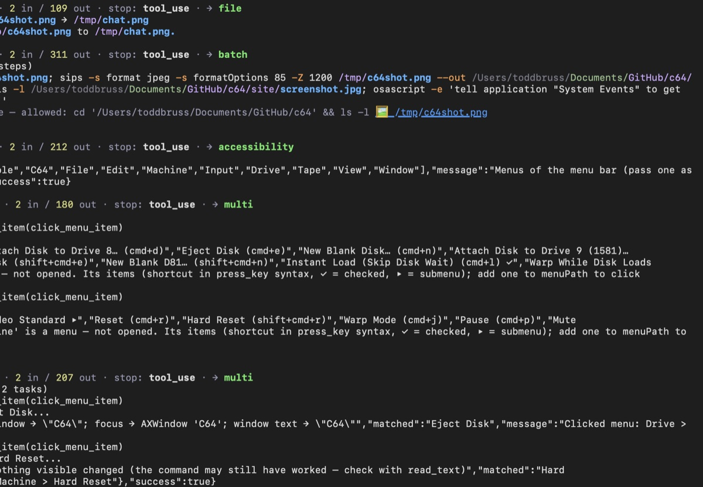

# C64 — a Commodore 64 emulator for macOS

Native Swift/AppKit emulator of a Commodore 64 (PAL or NTSC), with true emulation of the 1541
and 1581 disk drives and the Datasette. No third-party dependencies.

**Website:** https://c64.xcf.ai · **Download:** [latest release](https://github.com/AgentiLoop/c64/releases/latest) · Built with [AgentiLoop Agent!](https://agentiloop.ai)



## Quick start

1. Download `C64.app.zip` from the [releases page](https://github.com/AgentiLoop/c64/releases/latest),
   or build it yourself (see [Build & run](#build--run)). The app is ad-hoc signed: the first time,
   right-click it and choose **Open**.
2. Supply the Commodore ROMs (see [ROMs](#roms)).
3. Drop a `.d64`, `.d81`, `.prg`, `.t64` or `.tap` on the window, or use the Drive and Tape menus.
   Disks autostart with `LOAD"*",8,1` + `RUN`.

Requires macOS 13 or later.

## Status

| Part | State |
|------|-------|
| 6510 CPU | Cycle-exact bus accesses, all documented + undocumented opcodes, passes Klaus Dormann's functional test |
| Video standard | PAL (6569, 50 Hz, default) or NTSC (6567R8, 60 Hz) via Machine ▸ Video Standard; CPU, SID pitch, CIA clocks and drive timing follow; the KERNAL detects the machine itself |
| VIC-II (6569) | Cycle-stepped: badlines, sprite DMA/cycle stealing, border flip-flops, raster IRQ, all text/bitmap modes, sprites + collisions |
| SID (6581) | 3 voices, all waveforms, sync/ring, ADSR with real rate tables, resonant multimode filter, digi (volume DC) |
| CIA 6526 ×2 | Timers A/B, TOD, ICR, keyboard/joystick ports, VIC bank, IEC lines, NMI |
| Keyboard | Mac keyboard → C64 matrix (symbolic punctuation), RESTORE, joystick on numpad / cursor keys / game controllers |
| 1541 drive | True emulation: drive 6502 running the original DOS ROM, 2× VIA 6522, stepper head, GCR disk at the correct zone speeds; reads and writes |
| Media | D64 (autostart `LOAD"*",8,1` + `RUN`, Drive menu attach/eject/new blank disk, changes written back to the .d64), PRG autostart. T64 autostart, D81 on drive 9 (autostart `LOAD"*",9,1` + `RUN`) |
| 1581 drive (3.5") | True emulation as device 9: 2 MHz 6502 running the original 1581 DOS ROM, 8520 CIA, WD1772 controller (seek/step/restore, read/write sector, read address with real CRCs, write track so the drive's own `N:` format works), 80 tracks × 2 sides × 10 × 512-byte sectors; D81 attach/eject/new blank, changes written back |
| Fast loading | Instant Load (KERNAL LOAD trap for drives 8/9, on by default) and automatic warp while a drive motor runs (Drive menu) |
| Datasette | TAP v0/v1 playback into CIA1 FLAG at cycle precision, recording from the cassette write line (KERNAL SAVE to tape), TAP autostart (`LOAD` + `RUN`), Tape menu (insert/new/play/record/stop/rewind/eject), automatic warp while the tape motor runs, recordings written back to the .tap |

## ROMs

The Commodore ROMs are copyrighted and are not part of this repository. On first launch the
app looks in `~/Library/Application Support/C64Emu/ROMs`, in a VICE installation
(`/opt/homebrew/share/vice`, `/Applications/vice*`), or asks for a folder containing
`basic*.bin`, `kernal*.bin`, `chargen*.bin` (and optionally `dos1541*.bin`, `dos1581*.bin`).

Preferred file names (files are matched by name prefix and must be exactly this size):

| ROM | File name | Size | |
|---|---|---|---|
| BASIC | `basic-901226-01.bin` | 8 KB (8192 bytes) | required |
| KERNAL | `kernal-901227-03.bin` | 8 KB (8192 bytes) | required |
| CHARGEN | `chargen-901225-01.bin` | 4 KB (4096 bytes) | required |
| 1541 DOS | `dos1541-325302-01+901229-05.bin` | 16 KB (16384 bytes) | optional, drive 8 |
| 1581 DOS | `dos1581-318045-02.bin` | 32 KB (32768 bytes) | optional, drive 9 |

## Build & run

```sh
./scripts/make-app.sh      # builds build/C64.app
open build/C64.app
swift test -c release -Xswiftc -enable-testing   # unit + boot tests
C64_SLOW_TESTS=1 swift test -c release -Xswiftc -enable-testing --filter testFormat   # 1581 full format (~45 s)
```

## Keys

| Mac | C64 |
|-----|-----|
| Esc | RUN/STOP |
| Page Up | RESTORE |
| Left Option | C= |
| Tab / Control | CTRL |
| Home | CLR/HOME |
| F1–F8 | F1–F8 |
| Backspace / Fwd Delete | DEL / INST |
| Numpad 8/2/4/6, 0 or Right Option | Joystick (port 2 by default, ⌘K swaps) |
| ⌘V | Paste text as typing |
| ⌘J | Warp mode |
| ⌘1 / ⌘2 / ⌘3 | View: full border / small border / no border |
| ⌘D / ⌘E / ⌘N | Attach / eject / create D64 in drive 8 |
| ⌘L | Instant Load on/off (copies files straight from the disk image; directory, custom loaders still use the real drive) |
| ⌘⇧D / ⌘⇧E / ⌘⇧N | Attach / eject / create D81 in drive 9 (1581) |
| ⌘T / ⌘⇧T | Insert TAP / new blank TAP |
| ⌘⌥1–4 | Tape play / record / stop / rewind |

## License

The C64 emulator source in this repository is MIT licensed, see [LICENSE](LICENSE). This license does not cover AgentiLoop Agent!, the tool it was made with. Commodore ROMs and game software are not included and remain the
property of their owners.

## Website

`site/` is the source of https://c64.xcf.ai (static Cloudflare Worker assets): `cd site && npx wrangler deploy`.
